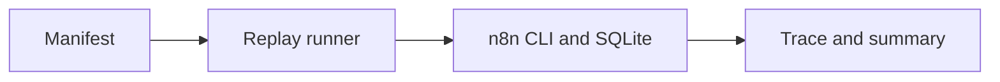

Changed: `src/replay/`, `tests/test_replay.py`, `workflows/baseline/DIFF.md`, task and ledger files changed.
Did: T7 added the local replay runner and ticked T7.
Did-not: T8, the scorer, gold files, PDFs, and the hardened workflow stayed unchanged.
Check: 26 unit tests and compileall passed, and secret grep found only known pattern literals.
Risk: the scorer reads `input_id` while the sink writes `replay_input_id`.
Next: T8.

