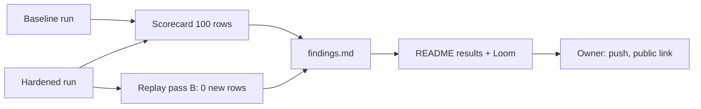

Changed: `evals/findings.md`, `README.md`, `specs/t2-rescue/tasks.md`, `.ai/STATUS.md`, `.ai/HANDOFF.md`, `.ai/REVIEW.md` (T13–T15); earlier commits T11, T12.
Did: T11 hardened run, T12 review, T13 findings, T14 README results and Loom script, T15 Sheets notes.
Did-not: the push, the public link, the owner trace notes, and `docs/DECISIONS.md`.
Check: 56 unit tests passed. Strict static checks passed. No secret value is in a committed file.
Check: hardened clean 49/50, duplicate rows 0, replay new rows 0, model calls 58 vs 100.
Risk: the T12 review is same-family. One PDF injection (t2-046) still changes an invoice number.
Next: owner gates only — trace notes, push, public link.

