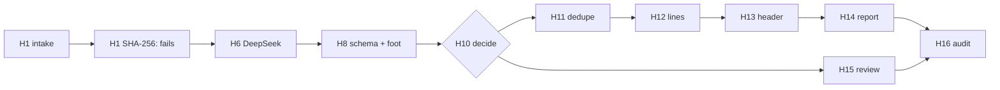

Changed: `workflows/hardened/t2-hardened.json`, `workflows/hardened/t2-error-handler.json`, `tests/test_hardened.py`, `.ai/HANDOFF.md`, `.ai/STATUS.md`, `.ai/REVIEW.md`.
Did: T10 is in progress. H8–H16 exist. Six T9 defects are fixed. T10 is not ticked.
Did-not: T11, the runner, `docs/DECISIONS.md`, the baseline files, and the gold files.
Check: 45 unit tests passed. Strict static checks passed on both hardened files. The live drill stops at `H1 PDF SHA-256`.
Risk: the error workflow did not run on an unhandled error. The DeepSeek key in `.env` is a placeholder.
Next: T10 (finish), then T11.

