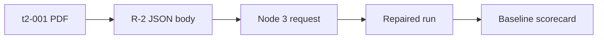

Changed: R-2, the replay runner, T8 records, the repaired run, and the baseline scorecard changed.
Did: T8 completed with a repaired run whose 100 submissions reached node 3.
Did-not: The as-published workflow, scorer, gold data, PDFs, and T9 stayed unchanged.
Check: The repaired scorecard has 50 rows from `baseline-local-20261007T060333Z-nogit`.
Risk: Node 9, recipient, currency, and lookup findings remain unfixed.
Next: A human reads 15 traces, then starts T9.

