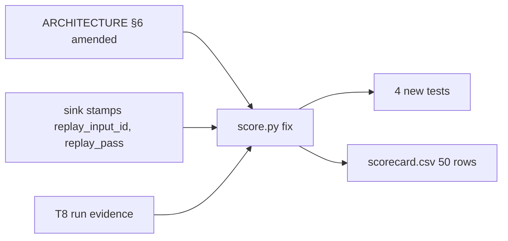

Changed: `docs/ARCHITECTURE.md` (§1.1, §6), `.ai/QUESTIONS.md` (Q-8), `specs/t2-rescue/plan.md`, `specs/t2-rescue/tasks.md`, `src/score/score.py`, `tests/test_score.py`, `evals/scorecard.csv`, `.ai/HANDOFF.md`, `.ai/STATUS.md`, `.ai/REVIEW.md`.
Did: T8a fixes four scorer rules and re-scores the T8 baseline run. The re-score uses no model call.
Did-not: T10, workflows, `docs/DECISIONS.md`, the sink, the runner, and the gold files.
Check: 33 unit tests passed. The 4 new tests fail on the old scorer. Compileall passed. The secret grep found only pattern literals.
Check: baseline codes now: duplicate_write 48, lineitem_mismatch 2, retry_storm 0, silent_drop 3, validate_skip 2, audit_gap 50.
Risk: Q-8 is open: DeepSeek prices, model id, and a baseline re-run on DeepSeek. Commits on `main` are not pushed.
Next: T10.

