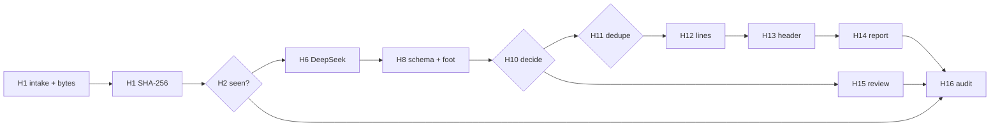

Changed: `workflows/hardened/t2-hardened.json`, `workflows/hardened/t2-error-handler.json`, `tests/test_hardened.py`, `specs/t2-rescue/tasks.md`, `.ai/QUESTIONS.md`, `.ai/HANDOFF.md`, `.ai/STATUS.md`, `.ai/REVIEW.md`.
Did: T10 adds H8–H16 and fixes the T9 defects. T10 is ticked.
Did-not: T11, the runner, `docs/DECISIONS.md`, the baseline files, and the gold files.
Check: 46 unit tests passed. Strict static checks passed on both files. The logic drill gave the expected route for 10 of 10 inputs.
Check: the invalid-key drill gave DeepSeek 401, one errors row, and audit status error. No row went to the ledger or the invoices.
Risk: the DeepSeek key in `.env` is a placeholder. T11 cannot call the model.
Next: T11.

