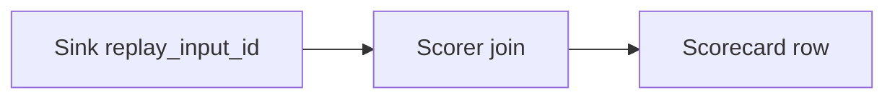

Changed: `src/score/score.py`, `tests/test_score.py`, `specs/t2-rescue/tasks.md`, `.ai/HANDOFF.md`, and `.ai/REVIEW.md`.
Did: The scorer now matches `replay_input_id` after its existing fallback fields.
Did-not: The runner, workflows, gold files, PDFs, and task checkboxes stayed unchanged.
Check: The focused scorer test passed without n8n or OpenAI.
Risk: T8 is blocked until the owner pins `n8nio/n8n:2.22.5`.
Next: T8.

