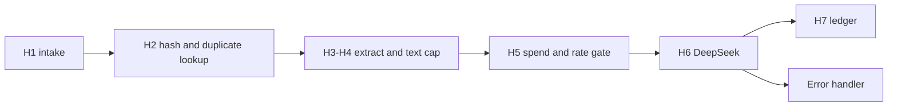

Changed: workflows/hardened/t2-hardened.json, workflows/hardened/t2-error-handler.json, specs/t2-rescue/tasks.md, .ai/HANDOFF.md, .ai/STATUS.md, and .ai/REVIEW.md changed.
Did: T9 adds guarded intake, extraction caps, DeepSeek extraction, and ledger writes.
Did-not: Baseline workflows, scorecard data, findings, and T10 nodes were left alone.
Check: 29 tests, compile, and strict static checks passed; secret grep found only scanner and test literals.
Risk: The fake-endpoint error drill is deferred to T10.
Next: T10.

